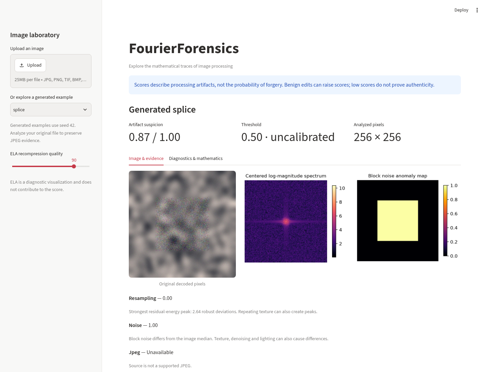
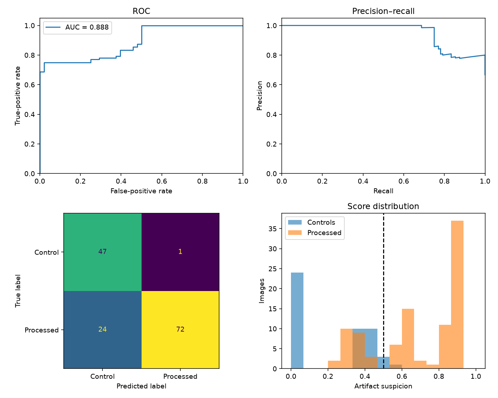
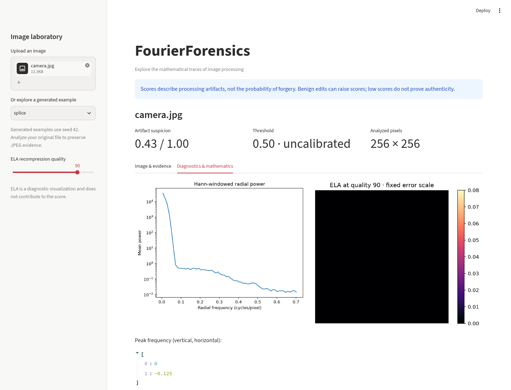

# FourierForensics

[](https://github.com/ghsihem228-ship-it/FourierForensics/actions/workflows/tests.yml)

**Host an interactive demo:** follow the [Streamlit Community Cloud deployment guide](docs/DEPLOYMENT.md). Deployment uses this repository's `main` branch, `app.py`, and Python 3.11; no API keys are required.

**Interpretable image-forensics clues through 2D Fourier analysis, noise statistics, and JPEG quantization.**

A Python 3.11 portfolio project connecting mathematics and information security. Upload an image to inspect its original pixels, Fourier spectrum, spatial noise-anomaly map, detector scores, and explanations. Everything runs locally; no model downloads, external image services, or dataset downloads are required.

This is an educational baseline. It detects some **processing artifacts**, which can come from benign editing as well as manipulation. The 0–1 suspicion score is **not a probability of forgery**. Low suspicion does not establish authenticity.



## Run locally

From the project folder, create a Python 3.11 environment and install the dependencies:

```bash
python3.11 -m venv .venv
source .venv/bin/activate
python -m pip install -r requirements.txt
streamlit run app.py
```

On Windows, use `py -3.11 -m venv .venv` and `.venv\Scripts\activate` for the first two commands. After setup, the one-command launch is **`streamlit run app.py`**. The sidebar includes six generated examples, so you can explore immediately.

The stack is NumPy, SciPy, OpenCV, scikit-learn, Matplotlib, Streamlit, Pillow (image I/O and JPEG tables), and pytest. Runtime requirements are bounded in `requirements.txt`; `requirements-lock.txt` records the complete environment used for the Python 3.11 benchmark. For that environment, substitute `pip install -r requirements-lock.txt`. The lock is a tested Linux snapshot including development tools, not a cross-platform dependency guarantee.

## Project map

| File | Responsibility |
| --- | --- |
| `fourierforensics/fft.py` | Validated luminance conversion, centred 2D FFT, log magnitude, radial averages |
| `fourierforensics/common.py` | Typed detector contract and Laplacian high-pass filter |
| `fourierforensics/detectors/resampling.py` | Residual-energy periodic peak detection |
| `fourierforensics/detectors/noise.py` | Block noise variance and spatial anomaly heatmap |
| `fourierforensics/detectors/jpeg.py` | ELA and approximate DCT double-quantization analysis |
| `fourierforensics/scoring.py` | Explicit score fusion and analysis pipeline |
| `fourierforensics/io.py` | Source-byte-preserving loading and JPEG helpers |
| `fourierforensics/synthetic.py` | Seeded scenes and manipulation generators |
| `app.py` | Streamlit interface and JSON summary download |
| `evaluate.py` | Dataset discovery, metrics, predictions, and plots |
| `scripts/generate_synthetic.py` | Dataset-generation CLI |
| `scripts/capture_screenshots.py` | Real browser upload checks and screenshot capture |
| `notebooks/demo.ipynb` | Mathematical walkthrough with executed code and figures |
| `tests/` | Numerical, detector, integration, loader, and UI tests |
| `results/synthetic/` | Actual measured results, per-image predictions, plot, and generation manifest |

Inputs to the numerical API are grayscale `(H,W)` or **RGB**, never OpenCV's BGR, `(H,W,3)`. Accepted dtypes are uint8, uint16, or finite floats in `[0,1]`. Detectors require at least 32 pixels per side. The loader limits uploads to 25 MiB and 16 megapixels, keeps source bytes, and does not resize or apply EXIF rotation. Display scaling does not change the analyzed pixels.

Transparent inputs are composited on white and flagged. Non-RGB/L uploads, including high-bit-depth modes, are converted to 8-bit RGB with a warning; numerical uint16 support does not imply full upload fidelity. Colour-space, high-bit-depth, multi-frame, ICC, and orientation assumptions are reported. Large images can take significant CPU and memory; full-resolution analysis intentionally avoids adding resize artifacts.

## Theory and implementation

### 1. Two-dimensional Fourier transform

For luminance $I(y,x)$ of size $H\times W$:

$$
F(u,v)=\sum_{y=0}^{H-1}\sum_{x=0}^{W-1}
I(y,x)\exp\left[-2\pi i\left(\frac{uy}{H}+\frac{vx}{W}\right)\right].
$$

`fft2_centered` returns `fftshift(fft2(I))`. Zero frequency is at `(H//2,W//2)`, including odd dimensions. NumPy's forward transform is unnormalized; Parseval's identity is

$$
\sum_{y,x}|I(y,x)|^2=\frac{1}{HW}\sum_{u,v}|F(u,v)|^2.
$$

The display is $L=\log(1+|F|)$. A separable Hann window reduces edge leakage:

$$
w(y,x)=h_H(y)h_W(x),\qquad
h_N(n)=\tfrac12\left[1-\cos\left(\frac{2\pi n}{N-1}\right)\right].
$$

The radial profile bins power into annuli with radius $r=\sqrt{f_x^2+f_y^2}$:

$$
A(r_j)=\frac{1}{|B_j|}\sum_{(u,v)\in B_j}|F(u,v)|^2.
$$

Frequencies use cycles/pixel, with each axis in approximately $[-0.5,0.5)$. Corner radii extend to $\sqrt{1/2}$. Empty annuli return NaN. The radial utility averages whatever **nonnegative real magnitude or power** it is given; the pipeline explicitly passes power, with Hann windowing and mean removal. Radial averaging discards direction, so it is descriptive rather than a standalone forgery test.

### 2. Resampling: periodic residual energy

Interpolation changes local sample correlations and can create periodic variance. First apply the discrete Laplacian with reflected boundaries:

$$
R=4I-I_{up}-I_{down}-I_{left}-I_{right}.
$$

Discard a four-pixel frame, then normalize residual energy locally:

$$
E=\frac{R^2}{G_{\sigma=3}*R^2+10^{-10}},\qquad
P=\left|\mathcal F\{w(E-\bar E)\}\right|^2.
$$

Let $D=\log(1+P)-\operatorname{median}_{9\times9}(\log(1+P))$. Over frequencies with $0.06<r<0.68$, compute a robust prominence:

$$
z=\frac{D-\operatorname{median}(D)}
{\max(1.4826\operatorname{MAD}(D),0.1)}.
$$

Take the strongest local maximum and map it to

$$
s_{resampling}=\operatorname{clip}\left(\frac{z_{max}-4}{4},0,1\right).
$$

The result also exposes the strongest peak coordinates and residual-energy spectrum. The hand-set constants are not significance thresholds corrected for multiple testing. This is a lightweight variance-periodicity heuristic **inspired by resampling forensics**, not a reproduction of the full Popescu–Farid EM probability-map method. JPEG block structure, screens, fabric, or other repetitive patterns can also create peaks.

### 3. Noise inconsistency and the splicing heatmap

For independent Gaussian noise with variance $\sigma^2$, the filter above has

$$
\operatorname{Var}(R)=\left(4^2+4\cdot(-1)^2\right)\sigma^2=20\sigma^2.
$$

For each approximately 32×32 block $b$, discard a one-pixel margin and estimate

$$
\hat\sigma_b=\frac{\operatorname{median}|R_b-\operatorname{median}(R_b)|}
{0.67448975\sqrt{20}},\qquad V_b=\hat\sigma_b^2.
$$

This MAD-based variance estimate is less sensitive to a few edges than the ordinary second moment. Equal partitions cover odd-sized images without unstable tiny remainder tiles. Set $\ell_b=\log(V_b+10^{-8})$, $m=\operatorname{median}(\ell)$ and

$$
d_b=\frac{|\ell_b-m|}{\max(1.4826\operatorname{MAD}(\ell),\log2)},\qquad
H_b=\operatorname{clip}\left(\frac{d_b-1}{3},0,1\right).
$$

The detector score is the mean of the largest $\lceil0.1B\rceil$ block anomalies. The map assigns each block's score to its actual pixels; it does not claim pixel-level localization. A separate 7×7 ordinary residual-variance diagnostic is also available. Texture, camera processing, saturation, and signal-dependent sensor noise violate the simple iid model.

### 4. JPEG: ELA and DCT histograms

**ELA is a visualization only**:

$$
ELA(y,x)=\operatorname{mean}_{c}\left|I_c(y,x)-J_q(I)_c(y,x)\right|.
$$

The UI defaults to $q=90$ and a fixed absolute error display scale `[0,0.08]`. It does not stretch each image independently to maximum brightness. Edges and texture can be bright without tampering. ELA does **not** contribute to the combined score.

For JPEG histogram analysis, level-shift luminance to $X=255I-128$ and apply the orthonormal DCT-II to complete 8×8 blocks:

$$
C_{u,v}=\alpha_u\alpha_v\sum_{y=0}^{7}\sum_{x=0}^{7}X_{y,x}
\cos\frac{\pi(2y+1)u}{16}\cos\frac{\pi(2x+1)v}{16},
\quad \alpha_0=1/\sqrt8,\quad \alpha_{k>0}=1/2.
$$

Single and aligned double quantization are approximated by

$$
K=\operatorname{round}(C/q_2),\qquad
K_2=\operatorname{round}\left(\frac{q_1}{q_2}\operatorname{round}(C/q_1)\right).
$$

Certain $q_1,q_2$ pairs create gaps or modulation in coefficient histograms. The final JPEG's luminance quantization table supplies $q_2$. Under a zero-mean Laplace coefficient model with CDF $F_b$:

$$
p_S(n)=F_b((n+\tfrac12)q_2)-F_b((n-\tfrac12)q_2),
$$

$$
p_D(n)=\sum_{k:\,\operatorname{round}(kq_1/q_2)=n}
\left[F_b((k+\tfrac12)q_1)-F_b((k-\tfrac12)q_1)\right].
$$

For eight low AC modes, compare fitted histogram log-likelihoods:

$$
g_j=\max\left(0,\frac{\max\log L_D-\max\log L_S-\frac12\log N}{N}\right),
\qquad
s_{JPEG}=\operatorname{clip}\left(\frac{\operatorname{median}_j g_j}{0.25},0,1\right).
$$

Implementation details are deliberate approximations: coefficient indices use NumPy rounding; histograms cover `-40..40` plus a tail bucket; PMFs use a fixed `[0.03,0.94,0.03]` smoothing kernel. Candidate first steps are integers `1..40,48,64,80`, restricted to $0.25\le q_1/q_2\le6$ and excluding ratios within 0.1 of one. Both models search five Laplace scales around the empirical mean absolute coefficient. The discrete PMF integrates primary indices from -4096 to 4096, with a probability floor and normalization. A mode needs at least 64 blocks and 32 nonzero coefficients; at least three usable modes are required. The likelihood penalty is a heuristic, not a calibrated statistical test with a guaranteed false-positive rate.

**The DCT is reconstructed from decoded pixels, not read from entropy-coded JPEG coefficients.** Decoding, chroma conversion, encoder rounding, clipping, and unknown processing can obscure or imitate artifacts. Without supported JPEG bytes and enough coefficients, the detector is marked unavailable and excluded from fusion. JPEG clues are global; the spatial heatmap comes from noise analysis.

### 5. Suspicion score

For available detectors $\mathcal A$, with weights `(resampling=0.40, noise=0.35, jpeg=0.25)`:

$$
S=0.75\max_{i\in\mathcal A}s_i+
0.25\frac{\sum_{i\in\mathcal A}w_i s_i}{\sum_{i\in\mathcal A}w_i}.
$$

This retains strong individual clues because different artifact types need not co-occur. Missing JPEG evidence is excluded; the remaining weights renormalize. Max-dominated fusion can also propagate an individual detector's false positive. Constants and the default threshold 0.5 are hand-set and uncalibrated. No classifier is trained; scikit-learn provides evaluation metrics.

## Synthetic data and tests

```bash
python -m scripts.generate_synthetic --output data/benchmark --count 24 --seed 1000
python -m pytest -q
python evaluate.py data/benchmark --output results/synthetic
```

Every source scene produces two controls (original PNG, single JPEG at quality 90) and four manipulated fixtures (bilinear ×1.5 resize, 17° rotation, higher-noise donor splice, aligned double JPEG 65→90). Rotation is centre-cropped to exclude padded corners. The generator writes `Au/`, `Tp/`, exact splice masks, and a manifest with source-group identifiers and seeds. It refuses to overwrite an existing generated dataset.

Resize and rotation are labelled positive in this **operation-detection** exercise, although either may be entirely benign. Noisy procedural scenes and deliberately mismatched-noise splices make this a controlled diagnostic exercise, not a realistic forgery collection.

Tests check known FFT peaks, Parseval and inverse identities, input conventions, interpolation evidence, spatial splice response, known noise variance, JPEG single/double controls, ELA behavior, score fusion, dataset discovery, evaluation output, invalid files, and Streamlit demo interactions. CI is configured for Python 3.11 and 3.12.

Optional development tools and notebook support:

```bash
python -m pip install -r requirements-dev.txt
ruff check .
ruff format --check .
python -m ipykernel install --user --name fourierforensics --display-name FourierForensics
```

Open `notebooks/demo.ipynb` with that kernel in Jupyter or VS Code. It contains real computed outputs. The notebook was executed with a real Jupyter kernel in the project environment.

To repeat actual browser upload, invalid-file, recovery, and mobile-width checks and capture screenshots:

```bash
playwright install chromium
python -m scripts.capture_screenshots
```

## Measured results

Committed run: Python **3.11.17**, 24 source scenes, seeds **1000–1023**, 144 images (48 controls, 96 manipulated), threshold **0.5**. The source seeds differ from detector unit-test and UI fixtures. No training or threshold tuning occurs during evaluation. Exact scores, hashes, and configuration are in `results/synthetic/metrics.json` and `predictions.csv`.

| Evaluation | Images | Precision | Recall | F1 | ROC-AUC |
| --- | ---: | ---: | ---: | ---: | ---: |
| Combined, controlled synthetic data | 144 | 0.986 | 0.750 | 0.852 | 0.888 |
| CASIA v2 | — | Not measured | Not measured | Not measured | Not measured |
| Columbia | — | Not measured | Not measured | Not measured | Not measured |

Confusion matrix: **TN=47, FP=1, FN=24, TP=72**. ROC-AUC measures ranking across thresholds, whereas recall describes the fixed threshold of 0.5. These fixtures are highly controlled and share one generator family; these measurements do not establish generalization.

| Operation | Count | Flagged at 0.5 | Interpretation |
| --- | ---: | ---: | --- |
| Original PNG | 24 | 0/24 | Negative control |
| Single JPEG | 24 | 1/24 | One false positive |
| Resize | 24 | 24/24 | Detectable interpolation evidence |
| Rotation | 24 | **0/24** | Stronger spectral clue, below the combined threshold |
| Higher-noise splice | 24 | 24/24 | Deliberately conspicuous variance mismatch |
| Double JPEG 65→90 | 24 | 24/24 | Favourable aligned quality pair |

Individual detector results, **with different availability cohorts**:

| Detector | Images | Precision | Recall | F1 | ROC-AUC |
| --- | ---: | ---: | ---: | ---: | ---: |
| Resampling | 144 | 0.733 | 0.344 | 0.468 | 0.633 |
| Noise | 144 | 1.000 | 0.250 | 0.400 | 0.745 |
| JPEG (single/double JPEG subset only) | 48 | 1.000 | 1.000 | 1.000 | 1.000 |

Detector rows are not directly comparable: the JPEG cohort contains only supported JPEG inputs, while the other rows include all manipulation types. The committed per-image CSV enables independent checking. Related derivatives share source scenes; image-level observations are not independent. No uncertainty interval is claimed.



## Evaluate CASIA v2 or Columbia

Obtain datasets from their distributors and respect their access terms. This repository does not redistribute them.

| Dataset layout under the chosen root | Authentic label 0 | Manipulated label 1 |
| --- | --- | --- |
| CASIA v2 style | `Au/` | `Tp/` |
| Columbia uncompressed colour | `4cam_auth/` | `4cam_splc/` |
| Generic supported folders | `auth/`, `authentic/`, `original/` | `tampered/`, `spliced/`, `forged/` |

```bash
python evaluate.py /path/to/CASIA2 --output results/casia
python evaluate.py /path/to/Columbia --output results/columbia
```

Discovery is recursive and case-insensitive for folder labels. Common mask/ground-truth folders are excluded. Ambiguous or unlabelled images cause an error; use a CSV manifest for other distributions rather than guessing labels:

```csv
path,label,group,operation
images/camera_a.jpg,0,scene_a,original
images/composite_a.png,1,scene_a,splice
```

```bash
python evaluate.py /path/to/data --manifest /path/to/labels.csv --output results/custom
```

A root `manifest.json` takes precedence over folder inference. All manifest paths are relative to the dataset root. Source groups are preserved in predictions. There is no train/test split because nothing is fitted; if you later tune thresholds, weights, or a classifier, split by source scene to avoid leakage. The original Columbia grayscale block dataset can require a manifest; the automatic Columbia mapping refers specifically to the uncompressed colour layout.

Outputs are `metrics.json`, `predictions.csv`, and `evaluation.png` (ROC, precision–recall, confusion matrix, score distributions). Positive means manipulated; a score **greater than or equal to** the threshold is flagged. A single-class cohort gets `null` ROC-AUC. Undefined Precision/Recall/F1 use zero. Corrupt images fail by default; `--skip-errors` explicitly records exclusions and their reasons. No threshold is optimized on the evaluation set.

## Interface diagnostics



The diagnostic tab also includes peak frequencies. The notebook shows the first usable AC histogram. The download contains an analysis summary, availability states, and warnings. The noise map is a block anomaly map, not a ground-truth segmentation. ELA is global recompression behavior and is kept separate from the noise map.

## Limitations

- **Artifacts do not establish intent.** Ordinary resizing, rotation, compression, sharpening, denoising, or computational photography can raise suspicion. The tool cannot tell a malicious edit from routine processing.
- **Repeating natural or synthetic textures can produce false spectral peaks.** JPEG grids, display captures, fabric, and architecture can resemble interpolation artifacts. Peak z scores are not calibrated p-values.
- **Some resampling is weak or invisible to this baseline.** Rotation sensitivity is especially limited: every rotation fixture in the committed benchmark is below the default combined threshold. There is no scale/angle estimator or spatial resampling localization.
- **Splicing can be invisible when noise and processing match.** Small, smooth, low-contrast, heavily compressed, or same-camera donor regions may be missed. Texture, lighting, saturation, and denoising can make innocent regions look anomalous. The noise model is simplistic and block resolution limits localization.
- **Double-JPEG sensitivity depends on quality pair and alignment.** Same-quality saves, some finer-to-coarser saves, grid shifts, low-information images, or subsequent processing may leave little evidence. Candidate quantization steps and the Laplace model are restricted. Estimated first steps are diagnostic hypotheses, not recovered camera settings.
- **Decoded DCT analysis is approximate.** This implementation does not extract original compressed coefficients, parse complete JPEG coding history, analyze CFA/PRNU, or implement a research-grade double-compression detector. PNG inputs have no automatic JPEG histogram score without supported source metadata.
- **ELA does not independently identify pasted content.** Bright recompression error is common at normal edges and texture; low error is not proof of authenticity.
- **No semantic, provenance, or AI-image authentication.** The tool does not identify false captions, altered meaning, a specific generator, a particular camera, or edits that preserve these statistics. Copy-move edits and convincing generative edits may evade it. It cannot recover an original image or reconstruct editing history.
- **Heuristics and scores are uncalibrated.** Hand-set thresholds, max-dominated fusion, and favourable synthetic fixtures need independent real-image validation. CASIA/Columbia performance is not measured here. Do not present these synthetic numbers as general image-forgery accuracy.

## Next experiments

Evaluate untouched camera images and benign edits alongside authentic forgeries; sweep resize factors, rotation angles, JPEG quality pairs, and alignment; test noise-matched splices and natural periodic textures. Compare exact compressed-coefficient analysis with reconstructed DCTs. If calibrating a supervised score, use source-disjoint train/validation/test sets and report confidence intervals clustered by source scene.

## References

These sources explain the underlying transforms and forensic ideas. The implementation is an educational approximation, not a claim to reproduce their full algorithms.

1. [NumPy DFT documentation](https://numpy.org/doc/stable/reference/routines.fft.html) — transform normalization, frequency ordering, and `fftshift`.
2. [SciPy `dctn`](https://docs.scipy.org/doc/scipy/reference/generated/scipy.fft.dctn.html) — multidimensional orthonormal DCT-II.
3. [Alin C. Popescu, Statistical Tools for Digital Image Forensics, Dartmouth dissertation](https://digitalcommons.dartmouth.edu/dissertations/10/) — resampling, noise, and compression evidence.
4. [Hany Farid, Digital Image Forensics tutorial](https://farid.berkeley.edu/downloads/tutorials/digitalimageforensics.pdf) — forensic concepts including double quantization.
5. [Columbia Uncompressed Image Splicing Detection Evaluation Dataset](https://www.ee.columbia.edu/ln/dvmm/downloads/authsplcuncmp/) — official colour-dataset layout and access information.

MIT licensed. See `LICENSE`.
